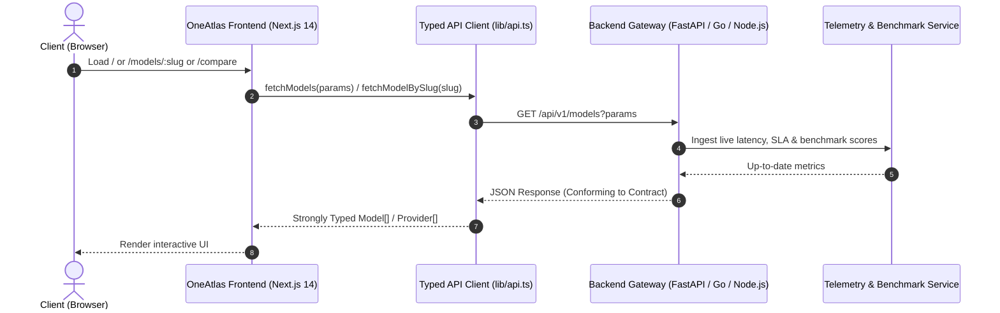

# OneAtlas — Backend Integration Contract & API Specification

**Platform:** [OneAtlas](https://oneatlas.dev/) — AI Model Discovery, Intelligence, Comparison & Evaluation Platform  
**Author:** Role 1 — Frontend Engineering & Architecture  
**Target Audience:** Role 2 (Backend Engineering) & Role 3 (Data/Scraping & ML Infrastructure)  
**Status:** PROPOSED & OPEN FOR BACKEND CONFIRMATION  
**Version:** 1.0.0 (Frontend-Ready Data Contracts)

---

## 1. Architectural Overview & Decoupling Strategy

The OneAtlas frontend is completely decoupled from backend persistence mechanisms and third-party scraping infrastructure. All network ingestion is routed through [`src/lib/api.ts`](file:///D:/Downloads/Intern/src/lib/api.ts), which queries either:
1. The Next.js API proxy (`/api/*`), or
2. A dedicated remote backend service configured via the `NEXT_PUBLIC_API_URL` environment variable.



---

## 2. API Endpoint Contracts

> [!IMPORTANT]
> Fields marked with **[CONFIRMATION REQUIRED]** represent proposals based on frontend requirements that must be validated by the backend and data teams before final production freeze.

### 2.1 Models Catalog API

* **Endpoint:** `GET /api/v1/models`
* **Purpose:** Powers the model discovery catalog, search, faceted sidebar filters, presets, and sorting algorithms.
* **Query Parameters:**
  * `search` (string, optional): Substring match against model name, developer, description, or tags.
  * `org` (string, optional): AI Laboratory slug (e.g., `anthropic`, `openai`, `deepseek`, `meta`).
  * `type` (string, optional): Model category (`Chat`, `Reasoning`, `Code`, `Multimodal`, `Embedding`, `Audio`).
  * `openWeights` (boolean, optional): `true` to filter models offering downloadable weights.
  * `maxPrice` (float, optional): Maximum input token price per 1M tokens in USD.
  * `minContext` (integer, optional): Minimum context window capacity in tokens.
  * `capability` (string, optional): Required capability (`vision`, `audio`, `tools`, `reasoning`).
  * `sortBy` (string, optional): Sort dimension (`popular`, `price-asc`, `price-desc`, `context-desc`, `arena-desc`, `speed-desc`, `release-desc`).
  * `page` (integer, optional): Page number for pagination *(Proposed)* **[CONFIRMATION REQUIRED]**.
  * `limit` (integer, optional): Items per page (default: 50) *(Proposed)* **[CONFIRMATION REQUIRED]**.

#### Response Payload (JSON)
```json
[
  {
    "id": "claude-3-5-sonnet",
    "slug": "claude-3-5-sonnet",
    "name": "Claude 3.5 Sonnet",
    "organization": {
      "id": "anthropic",
      "name": "Anthropic",
      "slug": "anthropic",
      "country": "United States",
      "website": "https://www.anthropic.com"
    },
    "description": "Frontier intelligence with industry-leading code and reasoning.",
    "modelType": "Chat",
    "modalities": {
      "input": ["text", "image"],
      "output": ["text"]
    },
    "contextWindow": 200000,
    "maxOutputTokens": 8192,
    "pricing": {
      "inputPerMillion": 3.00,
      "outputPerMillion": 15.00,
      "cachedInputPerMillion": 0.30,
      "currency": "USD"
    },
    "capabilities": {
      "toolCalling": true,
      "structuredOutputs": true,
      "vision": true,
      "audio": false,
      "reasoningTokens": false,
      "streaming": true,
      "openWeights": false
    },
    "benchmarks": {
      "lmsysArenaElo": 1342,
      "mmlu": 88.7,
      "gpqa": 65.0,
      "math": 78.3,
      "humanEval": 93.7
    },
    "latency": {
      "ttftMs": 420,
      "tokensPerSecond": 75
    },
    "releaseDate": "2024-10-22",
    "architecture": {
      "parameters": "Undisclosed",
      "license": "Proprietary Commercial"
    },
    "featured": true,
    "tags": ["frontier", "coding", "vision", "flagship"]
  }
]
```

---

### 2.2 Model Detail API

* **Endpoint:** `GET /api/v1/models/:slug`
* **Purpose:** Powers individual model profile pages, context meters, per-provider routing comparison tables, token cost calculators, and SDK integration tabs.
* **Path Parameters:**
  * `slug` (string, required): Model slug (e.g., `deepseek-r1`, `claude-3-5-sonnet`, `gpt-4o`).

#### Response Payload (JSON)
```json
{
  "id": "deepseek-r1",
  "slug": "deepseek-r1",
  "name": "DeepSeek R1",
  "organization": {
    "id": "deepseek",
    "name": "DeepSeek AI",
    "slug": "deepseek",
    "country": "China",
    "website": "https://www.deepseek.com"
  },
  "description": "Open-weight reasoning flagship with large-scale reinforcement learning.",
  "modelType": "Reasoning",
  "modalities": {
    "input": ["text"],
    "output": ["text"]
  },
  "contextWindow": 128000,
  "maxOutputTokens": 8192,
  "pricing": {
    "inputPerMillion": 0.55,
    "outputPerMillion": 2.19,
    "cachedInputPerMillion": 0.14,
    "currency": "USD"
  },
  "capabilities": {
    "toolCalling": true,
    "structuredOutputs": true,
    "vision": false,
    "audio": false,
    "reasoningTokens": true,
    "streaming": true,
    "openWeights": true
  },
  "benchmarks": {
    "lmsysArenaElo": 1361,
    "mmlu": 90.8,
    "gpqa": 71.5,
    "math": 97.3,
    "humanEval": 92.5
  },
  "latency": {
    "ttftMs": 680,
    "tokensPerSecond": 42
  },
  "providers": [
    {
      "providerId": "groq",
      "providerName": "Groq LPU",
      "inputPricePerMillion": 0.59,
      "outputPricePerMillion": 2.25,
      "latencyMs": 180,
      "tokensPerSecond": 190,
      "uptimePercent": 99.98,
      "status": "healthy",
      "contextLimit": 128000
    },
    {
      "providerId": "together",
      "providerName": "Together AI",
      "inputPricePerMillion": 0.55,
      "outputPricePerMillion": 2.19,
      "latencyMs": 420,
      "tokensPerSecond": 55,
      "uptimePercent": 99.95,
      "status": "healthy",
      "contextLimit": 128000
    },
    {
      "providerId": "fireworks",
      "providerName": "Fireworks AI",
      "inputPricePerMillion": 0.55,
      "outputPricePerMillion": 2.19,
      "latencyMs": 390,
      "tokensPerSecond": 60,
      "uptimePercent": 99.92,
      "status": "healthy",
      "contextLimit": 128000
    }
  ],
  "releaseDate": "2025-01-20",
  "architecture": {
    "parameters": "671B Total (37B Active MoE)",
    "license": "MIT Open Source"
  },
  "featured": true,
  "tags": ["reasoning", "open-weights", "stem", "math", "flagship"]
}
```

---

### 2.3 Inference Providers & Ecosystem API

* **Endpoint:** `GET /api/v1/providers`
* **Purpose:** Powers the `/providers` ecosystem directory, displaying cloud inference hosts, supported regions, SLA percentages, and average throughput.

#### Response Payload (JSON)
```json
[
  {
    "id": "groq",
    "name": "Groq",
    "slug": "groq",
    "description": "Deterministic tensor streaming architecture powered by custom Language Processing Units (LPUs).",
    "logo": "/providers/groq.svg",
    "website": "https://groq.com",
    "apiBaseUrl": "https://api.groq.com/openai/v1",
    "hostedModelCount": 12,
    "avgLatencyMs": 140,
    "avgThroughputTps": 280,
    "uptimePercent": 99.98,
    "status": "operational",
    "regions": ["us-east-1", "us-west-2", "eu-central-1"],
    "features": ["Sub-200ms TTFT", "Ultra-high TPS", "OpenAI Compatibility"]
  }
]
```

---

### 2.4 Benchmark Leaderboard API

* **Endpoint:** `GET /api/v1/benchmarks`
* **Purpose:** Powers the `/benchmarks` leaderboard, displaying domain scores across Arena ELO, HumanEval, MATH 500, MMLU, and GPQA.
* **Query Parameters:** *(Proposed)*
  * `domain` (string, optional): Specific domain to filter or sort (`arena`, `code`, `math`, `mmlu`, `gpqa`).

#### Response Payload (JSON)
```json
[
  {
    "rank": 1,
    "modelId": "deepseek-r1",
    "modelName": "DeepSeek R1",
    "slug": "deepseek-r1",
    "organization": "DeepSeek AI",
    "arenaElo": 1361,
    "mmlu": 90.8,
    "gpqa": 71.5,
    "math": 97.3,
    "humanEval": 92.5,
    "inputCost": 0.55,
    "outputCost": 2.19,
    "license": "MIT",
    "evaluationDate": "2025-01-22"
  }
]
```

---

## 3. Live Telemetry Architecture Evaluation

One of the key technical features of OneAtlas is displaying live latency (TTFT in milliseconds) and throughput (Tokens Per Second). The frontend engineering team has evaluated three communication strategies:

| Strategy | Feasibility | Overhead | Scalability | Recommendation |
| :--- | :--- | :--- | :--- | :--- |
| **REST Polling (every 30s - 60s)** | **Very High** | Low server load if cached via Redis/CDN edge | Scales gracefully to thousands of concurrent users | **Recommended for MVP & Phase 1** |
| **Server-Sent Events (SSE)** | **High** | Moderate (keeps HTTP connection open per client) | Excellent for real-time live route status alerts | **Recommended for Phase 2** |
| **WebSockets** | **Medium** | High server connection overhead, bidirectional not required | Overkill since client never transmits data back | Not recommended for read-only telemetry |

### Recommendation
1. **MVP / Initial Release:** Use **HTTP GET with conditional caching** (`stale-while-revalidate` or 30-second TTL). The backend or crawler periodically updates Redis every 60 seconds with probe results.
2. **Post-MVP:** Upgrade provider status changes (`healthy` -> `degraded` -> `down`) to a lightweight Server-Sent Events (SSE) feed (`/api/v1/telemetry/stream`).

---

## 4. Standardized Error Handling Protocol

All backend endpoints must adhere to the standardized RFC 7807 problem details specification to ensure clean client handling and meaningful toast feedback.

### Error Format
```json
{
  "error": {
    "code": "MODEL_NOT_FOUND",
    "message": "Model with slug 'invalid-model' was not found in active catalog.",
    "status": 404,
    "timestamp": "2026-11-21T09:30:00Z",
    "details": {
      "requestedSlug": "invalid-model"
    }
  }
}
```

### HTTP Status Codes Expected by Frontend:
* `200 OK`: Request successful.
* `400 Bad Request`: Invalid filter parameters (e.g., negative price or invalid enum).
* `404 Not Found`: Model or provider slug does not exist. Frontend renders `notFound()` boundary.
* `429 Too Many Requests`: Client rate limit reached. Frontend displays warning toast.
* `500 Internal Server Error`: Backend error. Frontend triggers fallback to local cache or `error.tsx`.

---

## 5. Critical Open Decisions for Backend Alignment

The following 6 questions require formal agreement between Role 1 (Frontend), Role 2 (Backend), and Role 3 (ML/Data):

1. **TTFT & TPS Measurement Methodology:**  
   * *Question:* How will provider latency (TTFT) and throughput (TPS) be captured?  
   * *Frontend Proposal:* Backend runs scheduled synthetic health checks (a standardized 50-token prompt like `"Hello world"`) once every 60 seconds per provider route and computes rolling averages over the last 15 minutes.
2. **Provider Health State Ingestion:**  
   * *Question:* Will provider health (`healthy`, `degraded`, `down`) be polled or pushed?  
   * *Frontend Proposal:* REST polling every 60 seconds for catalog views; fallback to static route listings if probe data is unavailable.
3. **Authoritative Pricing Source:**  
   * *Question:* Which system updates model token pricing (\$/1M input, \$/1M output, cached token discount)?  
   * *Frontend Proposal:* Role 3 scraper tracks official provider pricing pages and publishes updates to the backend PostgreSQL/database via administrative sync jobs.
4. **Benchmark Verification & Refresh Frequency:**  
   * *Question:* How are benchmark scores verified and updated?  
   * *Frontend Proposal:* Ingested from LMSYS Chatbot Arena Leaderboard weekly, plus verified research paper pass@1 scores. Each entry should include an `evaluationDate` and `sourceUrl`.
5. **Authentication & Rate Limits for Anonymous vs Registered Users:**  
   * *Question:* What authentication mechanism will gate public API queries?  
   * *Frontend Proposal:* Public routes (`/models`, `/providers`, `/benchmarks`) should remain unauthenticated with IP rate limiting (e.g., 60 req/min). User dashboards or API proxy access will pass `Authorization: Bearer <token>`.
6. **Graceful Handling of Globally Unavailable Models:**  
   * *Question:* What should the frontend display if a model exists in the catalog but has 0 active healthy provider routes?  
   * *Frontend Proposal:* Display an amber `"Temporarily Unavailable"` badge, disable the quickstart test runner, and show the reason (e.g., `"All provider routes undergoing scheduled maintenance"`).
