# ONEATLAS — CANDIDATE INTERVIEW PREPARATION & LOOM SCRIPT
**Role 1 — Frontend Engineering Selection**
**Target Product:** OneAtlas ([oneatlas.dev](https://oneatlas.dev/))
**Candidate Guide:** Comprehensive Technical Speaking Points & Presentation Strategy
**Date:** November 2026

---

## 1. 5–10 Minute Loom Video Presentation Script

Use this minute-by-minute breakdown during your screen-recording presentation. Keep your browser open to `http://localhost:3000` with devtools available.

```
00:00 - 01:15  | Section 1: Introduction, Problem Statement & Engineering Philosophy
01:15 - 03:00  | Section 2: Model Discovery, Multi-Faceted Filtering & Data Grid
03:00 - 04:45  | Section 3: Model Deep Dive, Hardware Telemetry & Token Estimator
04:45 - 06:30  | Section 4: Side-by-Side Comparison Matrix & Multi-Model ROI Calculator
06:30 - 08:00  | Section 5: Benchmarks Leaderboard, Provider Directory & Global ⌘K
08:00 - 09:30  | Section 6: Architecture, Performance, Bundle Optimization & Dark/Light System
09:30 - 10:00  | Section 7: Challenges Overcome & Backend Handoff Readiness
```

---

### Minute 0:00 – 01:15 | Section 1: Introduction, Problem Statement & Tech Stack
**What to show on screen:** Homepage (`http://localhost:3000`) in dark mode, showing the hero banner and model grid.
**Speaking Points:**
> "Hello everyone. My name is [Your Name], and this is my presentation for **Role 1 — Frontend Engineering** on **OneAtlas** (oneatlas.dev).
> 
> OneAtlas is an enterprise-grade AI model discovery, intelligence, and evaluation platform inspired by tools like OpenRouter, RouterPlus, and LiteLLM. As AI developers, choosing the right model involves balancing raw intelligence, context scale, token economics, and inference provider latency. My goal was to create a modern, high-density, accessible developer cockpit that turns overwhelming technical specs into clear decision-making tools.
> 
> For the tech stack, I strictly adhered to the mandatory requirements: **Next.js 14 App Router, React 19, TypeScript in strict mode, and Tailwind CSS** with a custom design system. Let's walk through the product experience."

---

### Minute 01:15 – 03:00 | Section 2: Model Discovery, Multi-Faceted Filtering & High-Density UI
**What to show on screen:** Toggle between Grid and Table views. Type "Claude" in search. Adjust the price slider down to $5/M. Select "Anthropic". Toggle the theme to Light mode, then back to Dark mode.
**Speaking Points:**
> "Starting on the primary catalog: developers consume information differently depending on context. I built both a visually rich **Card View** and a high-density **Data Table View** with sortable columns and contextual sparklines.
> 
> Notice the multi-faceted filtering sidebar:
> - You can search instantly by model name, organization, or capability.
> - Filter by AI research lab (OpenAI, Anthropic, DeepSeek, Google, Meta, Mistral).
> - Filter by modality (Vision, Audio, Tool Use, Reasoning).
> - And dynamically bound token costs using this continuous price slider.
> 
> Crucially, all filter states are synchronized bidirectionally with the browser URL. If I copy this link or click Back/Forward in the browser, the exact filter state is preserved. I also built a seamless two-way **Dark/Light Theme** system with carefully tuned slate tokens to ensure high contrast in bright office environments."

---

### Minute 03:00 – 04:45 | Section 3: Model Deep-Dive Page & Interactive Token Estimator
**What to show on screen:** Click into Claude 3.5 Sonnet (`/models/claude-3-5-sonnet`). Scroll through the architecture tags, context bar, pricing breakdown, interactive token estimator, and provider latency table.
**Speaking Points:**
> "Now let's drill down into an individual model: **Claude 3.5 Sonnet**.
> 
> The detail page gives developers everything they need to evaluate model fit:
> - A proportional context window gauge visualizing scales up to 2 million tokens.
> - Granular input vs. output pricing per million tokens.
> - An interactive **Token Playground Estimator**: developers can adjust expected prompt and completion token counts to see projected single-request costs in real time.
> - An **Inference Provider Telemetry Table** showing real-world hosting options—Groq, AWS Bedrock, Together AI—with actual metrics for Time-To-First-Token (TTFT), tokens-per-second throughput, and SLA uptime.
> - And verified benchmark percentiles across LMSYS Arena ELO, MMLU, and HumanEval."

---

### Minute 04:45 – 06:30 | Section 4: Comparison Matrix & Multi-Model Cost Simulator
**What to show on screen:** Click 'Add to Compare' on Claude 3.5 Sonnet. Open the comparison drawer. Click into DeepSeek R1 and add it. Click 'Compare Now' to navigate to `/compare`. Adjust the multi-model token sliders.
**Speaking Points:**
> "One of our most powerful features is the **Model Comparison Matrix**.
> 
> Developers can pin up to 4 models into a global **Comparison Drawer** that persists across page transitions via LocalStorage. Navigating to `/compare` unlocks a side-by-side spec diff:
> - Best-in-class values are automatically highlighted—like the lowest input price or highest Arena ELO.
> - If only one model is selected, a contextual helper banner recommends high-value counterpart models to compare.
> - Below the matrix, I engineered a **Multi-Model Cost Simulator**. By sliding expected prompt tokens, completion tokens, and monthly request volumes, the platform computes side-by-side monthly operational costs, highlighting exact dollar savings.
> - Comparisons are fully shareable via URL parameters."

---

### Minute 06:30 – 08:00 | Section 5: Benchmarks, Provider Directory & Command Palette
**What to show on screen:** Navigate to `/benchmarks`, switch tabs between Arena ELO, MMLU, and GSM8K. Show Value-for-Money index. Press `⌘K` or `Ctrl+K` to open the Command Palette. Type "Groq" or click a suggested tag.
**Speaking Points:**
> "Moving to **Rankings & Benchmarks**:
> - We provide interactive leaderboards sortable by Arena ELO, MMLU, GSM8K, and HumanEval, complete with comparative visual score bars.
> - We also compute a **Value-for-Money Index** (ELO points per dollar), which proves mathematically why models like DeepSeek R1 and Claude 3.5 Sonnet are dominating developer adoption.
> 
> For keyboard-first power users, pressing `⌘K` or `Ctrl+K` opens our global **Command Palette** from anywhere in the application. It features category filtering, auto-focused search, and clickable suggestion tags that allow instantaneous navigation to models, research labs, or tools."

---

### Minute 08:00 – 09:30 | Section 6: Architecture, Performance & Code Quality
**What to show on screen:** Terminal showing `npm run lint` and `npm run build` outputs. Open `src/lib/api.ts` in your editor.
**Speaking Points:**
> "Let's examine the engineering behind the UI:
> - **Zero Warnings:** Running `npm run lint` yields zero warnings and passes all Next.js Core Web Vitals checks.
> - **Font Optimization:** I migrated all typography to `next/font/google` with Inter and JetBrains Mono, eliminating Cumulative Layout Shift and external network calls.
> - **Bundle Efficiency:** The total shared First Load JS across all routes is just **87.3 kB**, ensuring rapid mobile loads.
> - **Clean Architecture:** In `src/lib/api.ts`, all data fetching is decoupled into a typed client layer. While the application currently runs reliably using Next.js route handlers and mock seeds, connecting this frontend to a remote PostgreSQL and NestJS backend requires changing only a single environment variable (`NEXT_PUBLIC_API_URL`)."

---

### Minute 09:30 – 10:00 | Section 7: Challenges Overcome & Closing
**What to show on screen:** Return to homepage with smooth theme toggle. Show `BACKEND_INTEGRATION_CONTRACT.md`.
**Speaking Points:**
> "During development, key challenges included managing bidirectional URL query synchronization without causing router re-render thrashing, and isolating theme CSS variables to avoid dark-mode bleeding. Both were resolved through dedicated layout-level subscribers and strict Tailwind class paradigms.
> 
> I have also prepared a complete **Backend Integration Contract** with RFC 7807 error specifications ready for the backend engineering team.
> 
> Thank you for your time and consideration. I welcome any questions about my architecture and look forward to the technical discussion!"

---

## 2. System Architecture & Component Hierarchy

```mermaid
flowchart TD
    subgraph Root Layout & Providers
        RootLayout["app/layout.tsx (Fonts, SEO Metadata)"]
        ClientLayout["app/ClientLayout.tsx (Theme, Global ⌘K Keydown)"]
        ToastProvider["context/ToastContext.tsx"]
        CompareProvider["context/CompareContext.tsx (LocalStorage Sync)"]
    end

    subgraph Navigation & Global UI
        Header["components/Header.tsx (Nav & Theme Toggle)"]
        Footer["components/Footer.tsx"]
        CommandPalette["components/CommandPalette.tsx (⌘K Modal)"]
        ComparisonDrawer["components/ComparisonDrawer.tsx (Floating Dock)"]
    end

    subgraph Application Routes
        Catalog["/ (Model Discovery Catalog)"]
        Detail["/models/[slug] (Model Specs & Playground)"]
        Compare["/compare (Side-by-Side Matrix & Cost Simulator)"]
        Benchmarks["/benchmarks (Leaderboards & ELO Ranking)"]
        Providers["/providers (AI Labs & Inference Hosts)"]
        Calculator["/calculator (Token Economics & ROI)"]
        NotFound["/_not-found (Branded 404 Error Boundary)"]
    end

    subgraph Presentation Components
        ModelFilters["components/ModelFilters.tsx"]
        ModelTable["components/ModelTable.tsx"]
        ModelCard["components/ModelCard.tsx"]
    end

    subgraph Data & API Layer
        APIClient["lib/api.ts (Typed API Client)"]
        APIRoutes["app/api/* (Next.js Route Handlers)"]
        MockData["data/mockData.ts (Normalized Seed Dataset)"]
    end

    RootLayout --> ClientLayout
    ClientLayout --> ToastProvider
    ClientLayout --> CompareProvider
    CompareProvider --> Header
    CompareProvider --> Footer
    CompareProvider --> CommandPalette
    CompareProvider --> ComparisonDrawer
    CompareProvider --> ApplicationRoutes

    Catalog --> ModelFilters
    Catalog --> ModelTable
    Catalog --> ModelCard

    Catalog --> APIClient
    Detail --> APIClient
    Compare --> APIClient
    Benchmarks --> APIClient
    Providers --> APIClient

    APIClient --> APIRoutes
    APIRoutes --> MockData
```



---

## 3. Key Technical Decisions & Justifications

### 1. Next.js 14 App Router vs. Pages Router
- **Decision:** Built entirely on the modern App Router (`src/app/`).
- **Justification:** Enables nested layouts, unified server/client component boundaries, automatic code-splitting per route, modern `next/font` zero-CLS font loaders, and co-located route handlers (`/api/*`).

### 2. Context API + LocalStorage vs. Redux Toolkit / Zustand
- **Decision:** Utilized lightweight native React Contexts (`CompareContext`, `ToastContext`) coupled to `localStorage`.
- **Justification:** Avoided external state dependencies (saving 30+ kB of bundle size). The application has two distinct pieces of cross-cutting state: the comparison selection tray (1–4 models) and toast alerts. Native React 19 hooks provide optimal performance without unnecessary boilerplate or store hydration issues.

### 3. Tailwind CSS & Semantic Tokens vs. Pre-Built UI Kits (MUI/AntD)
- **Decision:** Custom design system built with Tailwind CSS and semantic slate/sky tokens.
- **Justification:** Pre-built UI kits add heavy bundle overhead, rigid DOM structures, and difficult dark-mode overrides. Tailwind provides sub-millisecond styling, zero runtime CSS-in-JS overhead, complete control over responsive breakpoints, and exact parity with high-density developer platforms like OpenRouter and GitHub.

### 4. Hybrid Client-Side Filtering with URL State Synchronization
- **Decision:** In-memory filtering of seed models with bidirectional `window.history.replaceState` and `useSearchParams` URL reflection.
- **Justification:** Delivers zero-latency keystroke search (< 1ms) while preserving deep-linking capabilities. When an external backend API is connected, the identical filter schema translates directly to URL query parameters via `api.getModels(filters)`.

---

## 4. Top 10 Technical Interview Questions & High-Impact Answers

### Q1: How did you handle font loading and Cumulative Layout Shift (CLS)?
**Answer:** "I utilized `next/font/google` to load `Inter` and `JetBrains_Mono` with CSS variable injection (`--font-inter`, `--font-mono`). Next.js automatically self-hosts the Google Font binaries at build time, eliminating external runtime HTTP requests to Google servers, preventing FOIT/FOUT, and reducing CLS to zero."

### Q2: Why did you lift the keyboard shortcut listener to `ClientLayout` instead of keeping it in `CommandPalette`?
**Answer:** "Originally, the keydown event listener was inside `CommandPalette.tsx`. However, because the modal only mounted when `isOpen` was true, pressing `⌘K` or `Ctrl+K` on the page did nothing. By lifting the listener to `ClientLayout.tsx` at the root window level, the listener is always active regardless of which route or modal is rendered."

### Q3: How do you prevent layout thrashing and re-renders during rapid filter changes?
**Answer:** "Filter inputs maintain local state and trigger memoized array transformations using `useMemo`. Instead of pushing new history entries to the Next.js router on every keystroke—which would trigger server-side re-evaluations—we synchronize the URL query string using `window.history.replaceState`. This preserves the browser URL without incurring unnecessary React reconciliations."

### Q4: How is your comparison state persisted across browser refreshes and page transitions?
**Answer:** "In `CompareContext.tsx`, state is initialized from `localStorage.getItem('oneatlas_compare_models')` during client mount. Whenever a model is added or removed, state updates trigger a write to `localStorage`. Furthermore, `/compare` generates a shareable URL containing `?models=slug1,slug2`, allowing users to share comparison links across different browsers and devices."

### Q5: How would you scale this frontend if the catalog expanded to 10,000 models?
**Answer:** "For a 10,000 model catalog, two changes would be implemented:
1. **Virtualization:** In `ModelTable.tsx` and the grid view, we would implement `@tanstack/react-virtual` to render only the visible DOM nodes in the viewport (~15 rows at a time), keeping DOM memory constant.
2. **Server-Side Pagination & Debounced Search:** The client-side filter would transition to server-driven pagination via `api.getModels({ page, limit: 50, search })` with a 250ms debounce on the search input."

### Q6: How does the application maintain accessibility standards?
**Answer:** "We follow semantic HTML5 structures (`main`, `nav`, `section`, `header`, `footer`, `table`). Interactive elements include appropriate ARIA attributes, such as `role='dialog'` and `aria-modal='true'` on the Command Palette, visible `:focus-visible` focus rings for keyboard navigation, and high contrast ratios (> 4.5:1) in both dark and light modes."

### Q7: Explain the mathematical calculation used in the Token Economics Calculator.
**Answer:** "The calculator accurately reflects industry billing models:
$$\text{Total Cost} = \left(\frac{\text{Prompt Tokens} \times \text{Volume}}{1,000,000} \times \text{Price}_{\text{input}}\right) + \left(\frac{\text{Completion Tokens} \times \text{Volume}}{1,000,000} \times \text{Price}_{\text{output}}\right)$$
We separate prompt and completion tokens because frontier models charge significantly higher rates for output generation (e.g. Claude 3.5 Sonnet is $3.00/M input vs $15.00/M output). The UI provides immediate feedback on cost breakdowns and annual operational projections."

### Q8: What is your strategy for handling backend errors or offline states?
**Answer:** "In `src/lib/api.ts`, API requests are wrapped in try-catch blocks. If the backend fails or returns a non-200 status, the client catches the error, triggers an informative toast notification via `useToast`, and gracefully falls back to cached seed data. For route failures, Next.js error boundaries and custom `not-found.tsx` catch malformed slugs."

### Q9: What is the difference between real data and simulated telemetry in this build?
**Answer:** "All model specifications, context windows, official per-token prices, LMSYS Arena ELO rankings, and academic benchmark scores are real and verified. Telemetry metrics such as live Time-To-First-Token (TTFT) and tokens-per-second throughput are simulated using deterministic baselines representative of actual provider performance (e.g., Groq at ~280 tok/s vs standard GPU cloud at ~50 tok/s)."

### Q10: If a backend engineer delivers the REST or GraphQL API tomorrow, what changes on the frontend?
**Answer:** "Zero UI components need to be modified. Because all API communications are abstracted through `src/lib/api.ts` and adhere to [BACKEND_INTEGRATION_CONTRACT.md](file:///d:/Downloads/Intern/BACKEND_INTEGRATION_CONTRACT.md), the backend engineer simply configures `NEXT_PUBLIC_API_URL` to point to their service. The client models and error handling are already typed to the agreed-upon contract."
