# OneAtlas — Role 1: Frontend Engineering Master Specification

**Platform:** [OneAtlas](https://oneatlas.dev/) — AI Model Discovery, Intelligence, Comparison & Evaluation Platform  
**Target Reference Ecosystem:** [OpenRouter](https://openrouter.ai/), [RouterPlus](https://routerplus.com/), [LiteLLM](https://www.litellm.ai/)  
**Role:** Senior Frontend Architect, Staff Next.js Engineer, UI/UX Designer & Code Quality Specialist (Role 1)  
**Status:** Production Ready (Compiled Cleanly with Next.js 14 App Router, TypeScript, Tailwind CSS)  
**Production Host:** `http://localhost:3000` (All 6 core routes verified returning HTTP 200)

---

## 1. System Architecture & Topology

```mermaid
graph TD
    Client["Client Browser (Desktop / Tablet / Mobile)"]

    subgraph Design_System [Design System & Theme Engine]
        ThemeContext["ThemeContext (Cyber Dark #0B0F17 Default / Clean Light #F8FAFC)"]
        ToastContext["ToastContext (Non-Blocking Floating Notification Stack)"]
        Fonts["next/font/google (Inter & JetBrains Mono Zero-CLS Self-Hosting)"]
    end

    subgraph State_Management [State Management & Deep Linking]
        CompareContext["CompareContext (Active Selection 2–4 Models, Limit Enforced)"]
        URLParams["Bidirectional Query Param Sync (?q, ?org, ?cap, ?models, ?view)"]
        LocalStorage["Client Storage (Theme & Comparison Persistence)"]
    end

    subgraph Component_Hierarchy [Presentation & Interactive UI Layer]
        Header["Global Header (Brand, Telemetry, Mobile Drawer, Theme Switcher)"]
        Palette["Command Palette (⌘K / Ctrl+K with Arrow Key & Enter Navigation)"]
        CatalogView["Model Discovery Catalog (Faceted Sidebar, Grid/Table Switcher)"]
        DetailView["Model Profile Route (/models/[slug], Context Gauge, Provider Matrix)"]
        CompareView["Side-by-Side Diff Matrix (/compare, 13 Dimensions, Cost Simulator)"]
        LeaderboardView["Benchmark Leaderboard (/benchmarks, Arena ELO, Code, Math, MMLU)"]
        DirectoryView["Directory (/providers, Frontier Labs vs GPU Cloud Runtimes)"]
        CalculatorView["Inference Cost & ROI Calculator (/calculator, DAU & Token Forecasts)"]
        Drawer["Floating Bottom Comparison Dock (Live Selection Badges & Direct Diff)"]
        Footer["Global Platform Footer (Ecosystem Links, Documentation, Disclaimers)"]
    end

    subgraph Data_Layer [Data Contracts & Decoupled Ingestion]
        APIClient["Typed API Client (src/lib/api.ts)"]
        NextAPIRoutes["Next.js Route Handlers (/api/models, /api/providers, /api/benchmarks)"]
        DomainModels["TypeScript Interfaces (Model, Provider, BenchmarkEntry, ProviderRoute)"]
    end

    Client --> Design_System
    Design_System --> State_Management
    State_Management --> Component_Hierarchy
    Component_Hierarchy --> Data_Layer
```



---

## 2. Directory Structure & File Map

```
d:\Downloads\Intern/
├── package.json                    # Next.js 14, React 18, TypeScript, Tailwind, Lucide, Typography, ESLint
├── tailwind.config.ts              # Cyber dark slate palette, typography & animation keyframes
├── tsconfig.json                   # Strict TypeScript compiler options & '@/*' path alias
├── next.config.mjs                 # Production optimization & strict React mode configuration
├── .eslintrc.json                  # Next.js Core Web Vitals ESLint configuration
├── BACKEND_INTEGRATION_CONTRACT.md # Formal API contract for Role 2 (Backend) and Role 3 (Data)
├── ROLE_1_QA_AND_VERIFICATION_REPORT.md # Comprehensive QA audit, mathematical checks & browser test results
└── src/
    ├── app/
    │   ├── api/                    # Decoupled RESTful API route handlers
    │   │   ├── benchmarks/         # GET /api/benchmarks (Leaderboard data)
    │   │   ├── models/             # GET /api/models (Catalog search & faceted query engine)
    │   │   │   └── [slug]/         # GET /api/models/[slug] (Model detail with provider routes)
    │   │   └── providers/          # GET /api/providers (Hosting cloud & lab telemetry)
    │   ├── benchmarks/             # SOTA Benchmark Leaderboard page
    │   │   └── page.tsx
    │   ├── calculator/             # Enterprise Inference Cost & ROI Calculator
    │   │   └── page.tsx
    │   ├── compare/                # Side-by-Side Multi-Model Comparison Matrix
    │   │   └── page.tsx
    │   ├── models/
    │   │   └── [slug]/             # Dynamic Model Profile with Provider Routing & SDK tabs
    │   │       └── page.tsx
    │   ├── providers/              # Frontier Labs & GPU Inference Providers directory
    │   │   └── page.tsx
    │   ├── ClientLayout.tsx        # Client root wrapper (Theme + Toast + Compare Providers)
    │   ├── error.tsx               # Production error boundary with retry mechanisms
    │   ├── globals.css             # Design tokens, scrollbar styling & dark/light CSS variables
    │   ├── layout.tsx              # Root HTML/Body layout with next/font/google self-hosting
    │   ├── loading.tsx             # Universal Suspense loading skeleton state
    │   └── page.tsx                # Model Discovery & Catalog (Faceted search & Grid/Table)
    ├── components/
    │   ├── CommandPalette.tsx      # Global Spotlight search (⌘K / Ctrl+K) with keyboard focus
    │   ├── ComparisonDrawer.tsx    # Persistent bottom drawer showing active comparison models
    │   ├── Footer.tsx              # Platform footer with ecosystem links and disclaimer
    │   ├── Header.tsx              # Top navigation bar, telemetry status, mobile drawer, theme toggle
    │   ├── ModelCard.tsx           # High-density telemetry card for grid catalog view
    │   ├── ModelFilters.tsx        # Faceted sidebar filter panel with range sliders & category presets
    │   └── ModelTable.tsx          # Dense monospace developer table for technical evaluation
    ├── context/
    │   ├── CompareContext.tsx      # Multi-model selection state (2-4 models) with toast feedback
    │   ├── ThemeContext.tsx        # Dark slate / Clean light mode context provider
    │   └── ToastContext.tsx        # Interactive floating notification stack
    ├── data/
    │   └── mockData.ts             # Deterministic foundation model dataset (9 frontier models, 6 hosts)
    ├── lib/
    │   └── api.ts                  # Decoupled, strongly typed async client fetching functions
    └── types/
        └── index.ts                # TypeScript domain models, interfaces, and filter contracts
```

---

## 3. Seven-Stage Technical Implementation Details

### Stage 1: Design System & Theming
- **Dark Theme Tokens:** `#0B0F17` (Obsidian Slate), `#111827` (Card Surface), `#0284C7` (Sky Primary), `#10B981` (Emerald Speed), `#F59E0B` (Amber Arena ELO), `#8B5CF6` (Violet Reasoning).
- **Light Theme Tokens:** `#F8FAFC` (Clean Slate Canvas), `#FFFFFF` (Card Surface), `#0284C7` (High-contrast Primary), `#0F172A` (Charcoal Headings).
- **Typography:** Self-hosted `Inter` for prose and headings; `JetBrains Mono` for latency, throughput, token pricing, and code blocks.

### Stage 2: Model Discovery & Catalog
- **Dual Presentation Mode:** Instant toggle between rich cards (`ModelCard.tsx`) and dense tabular figures (`ModelTable.tsx`).
- **Real-Time Faceted Query Engine:** Supports substring search, multi-org selection, capability toggles (Vision, Audio, Tool Calling, Reasoning Tokens, Open Weights), price threshold slider (\$0.10 - \$20.00/1M), and context threshold slider (32k - 2M tokens).
- **Bidirectional Deep-Linking:** Full synchronization of filter state with URL query parameters (`window.history.replaceState`), enabling shareable search states.

### Stage 3: Spotlight Command Palette (`⌘K` / `Ctrl+K`)
- Mounts as a modal overlay on every page with keyboard focus management.
- Supports arrow key traversal (`↑`/`↓`), `Enter` navigation, and `Escape` dismissal.
- Indexes models, inference hosts, benchmark rankings, and utility tools.

### Stage 4: Model Profile & Routing (`/models/[slug]`)
- Dynamic route rendering 2M context gauge meter, blended token pricing, and live provider route comparison table.
- Available Provider table displays provider name, input/output price, TTFT latency, throughput (TPS), uptime SLA (99.9%), and health status.
- Interactive token cost estimator and drop-in OpenAI-compatible SDK snippets (TypeScript, Python, cURL) with clipboard feedback.

### Stage 5: Multi-Model Comparison Matrix (`/compare`)
- Head-to-head comparison of 2–4 models across 13 technical dimensions.
- Visual difference highlighting for cheapest input cost, largest context window, and highest Arena ELO.
- Integrated Token Cost Simulator calculating projected monthly expenditure across selected models under identical workloads with net savings derivation.

### Stage 6: Benchmarks, Providers & Economics Calculator
- **Benchmark Leaderboards (`/benchmarks`):** Domain filtering across LMSYS Arena ELO, HumanEval, MATH 500, MMLU, and GPQA.
- **Provider Directory (`/providers`):** Separates Model Creators (Anthropic, OpenAI, DeepSeek, Meta) from Cloud GPU Hosts (Groq, Together AI, Fireworks, Bedrock).
- **Inference Cost Calculator (`/calculator`):** Complete enterprise financial model factoring in DAU, queries/user, prompt/completion token lengths, and prompt caching discounts.

### Stage 7: Decoupled API Integration Readiness
- Configured via `NEXT_PUBLIC_API_URL` in `src/lib/api.ts`.
- Complete integration specifications and 6 open architectural decisions documented in `BACKEND_INTEGRATION_CONTRACT.md`.
